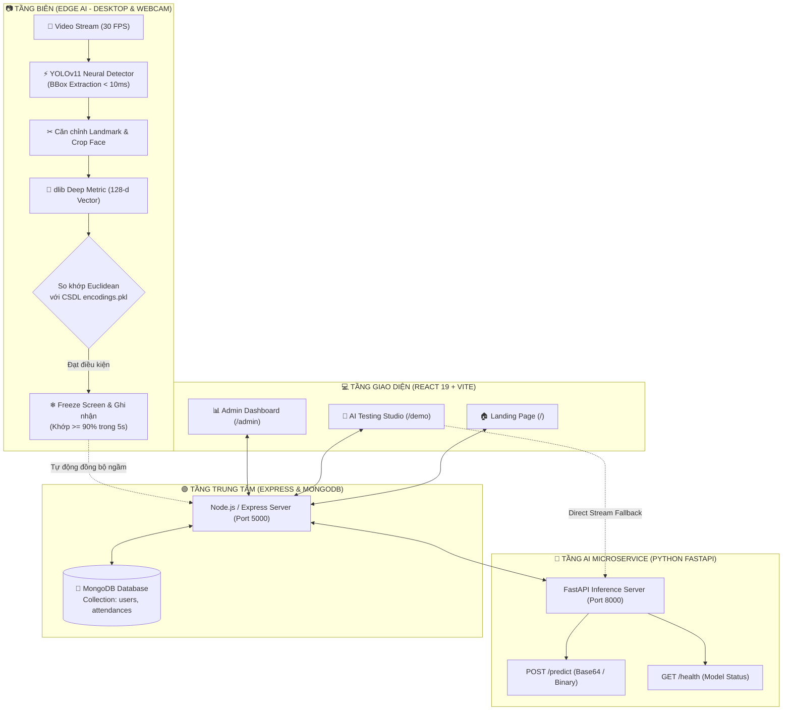

<div align="center">

```
  ███████╗ █████╗  ██████╗███████╗    ██████╗ ███████╗████████╗███████╗ ██████╗████████╗
  ██╔════╝██╔══██╗██╔════╝██╔════╝    ██╔══██╗██╔════╝╚══██╔══╝██╔════╝██╔════╝╚══██╔══╝
  █████╗  ███████║██║     █████╗      ██║  ██║█████╗     ██║   █████╗  ██║        ██║   
  ██╔══╝  ██╔══██║██║     ██╔══╝      ██║  ██║██╔══╝     ██║   ██╔══╝  ██║        ██║   
  ██║     ██║  ██║╚██████╗███████╗    ██████╔╝███████╗   ██║   ███████╗╚██████╗   ██║   
  ╚═╝     ╚═╝  ╚═╝ ╚═════╝╚══════╝    ╚═════╝ ╚══════╝   ╚═╝   ╚══════╝ ╚═════╝   ╚═╝   
                        ⚡ M E R N   S T A C K   E D I T I O N ⚡
```

### *Next-Gen Multimodal Face Recognition & Real-time Attendance Ecosystem*
### *Hệ Thống Điểm Danh & Nhận Diện Khuôn Mặt Đa Tầng Thế Hệ Mới*

---

[](https://www.python.org/)
[](https://github.com/ultralytics/ultralytics)
[](http://dlib.net/)
[](https://fastapi.tiangolo.com/)
[](https://react.dev/)
[](https://vitejs.dev/)
[](https://expressjs.com/)
[](https://www.mongodb.com/)
[](design.md)
[](LICENSE)

<br/>

<p align="center">
  <b>Sự kết hợp hoàn hảo giữa công nghệ Edge AI (YOLOv11 + dlib ResNet) và nền tảng Full-stack Web hiện đại theo triết lý Swiss Minimalist White.</b>
</p>

[✨ Điểm Nhấn](#-điểm-nhấn-công-nghệ) •
[🏛️ Kiến Trúc](#-kiến-trúc-tích-hợp-đa-tầng) •
[📂 Cấu Trúc Mã Nguồn](#-cấu-trúc-thư-mục-dự-án) •
[🎨 Giao Diện Web](#-giao-diện-web-swiss-minimalist-white) •
[🚀 Cài Đặt & Chạy](#-hướng-dẫn-cài-đặt--khởi-chạy) •
[📡 Tài Liệu API](#-hệ-thống-api-endpoints) •
[📑 Báo Cáo Kỹ Thuật](#-tài-liệu-liên-quan)

---

</div>

## 🌟 Điểm Nhấn Công Nghệ

| Thành Phần | Công Nghệ | Đặc Tính & Chỉ Số Vượt Trội |
|---|---|---|
| **Face Detector** | **YOLOv11 Face** | Độ trễ suy luận siêu tốc **< 10ms/frame**, bắt trọn khuôn mặt ở góc nghiêng lớn, khoảng cách xa và điều kiện ngược sáng. |
| **Feature Extractor** | **dlib ResNet-34** | Trích xuất **vector đặc trưng 128 chiều**, độ chính xác chuẩn benchmark LFW đạt **99.38%**. |
| **Học Đa Góc Độ** | **Multi-angle Capture** | Cơ chế học **20 góc mặt** (thẳng, nghiêng trái/phải, ngửa/cúi, cười...) giúp nhận diện không góc chết. |
| **Cơ Chế Khóa Điểm Danh**| **Freeze Screen Engine** | Tự động **đóng băng 1 giây** và lưu chứng thực khi phát hiện khuôn mặt giữ độ tin cậy $\ge 90\%$ trong **5 giây liên tục**. |
| **AI Microservice** | **FastAPI (Asynchronous)** | Cung cấp cổng REST API thời gian thực xử lý luồng Base64 Canvas/Blob mượt mà cho giao diện Web. |
| **Giao Diện Web** | **React 19 + Swiss Style** | Thiết kế thẩm mỹ đỉnh cao theo chuẩn **Minimalist White SaaS**, font Geist + Instrument Serif, hỗ trợ Dark/Light, bo góc Pill 40px. |
| **Backend & CSDL** | **Node.js + MongoDB** | Quản lý định danh nhân sự, phân trang lịch sử chấm công, thống kê trực quan theo ngày/tháng. |

---

## 🏛️ Kiến Trúc Tích Hợp Đa Tầng



---

## 📂 Cấu Trúc Thư Mục Dự Án

```plaintext
Face-Detect-MERN-Stack/
│
├── 🧠 face_detect/                   # MODULE TRÍ TUỆ NHÂN TẠO (PYTHON AI)
│   ├── config.py                     # Cấu hình tham số (Tolerance 0.48, Camera, YOLO conf)
│   ├── face_service.py               # Thuật toán lai: YOLOv11 Detector + dlib 128-d Metric
│   ├── app.py                        # App Desktop OpenCV (Đăng ký 20 góc mặt & Điểm danh)
│   ├── api_server.py                 # FastAPI AI Microservice (Port 8000) phục vụ Web
│   ├── models/
│   │   └── yolov11n-face.pt          # Trọng số mạng YOLOv11 Face
│   ├── data/
│   │   ├── encodings.pkl             # Cơ sở dữ liệu vector khuôn mặt nạp tức thì < 0.01s
│   │   ├── faces/                    # Kho ảnh mẫu các góc mặt nhân viên
│   │   ├── checkins/                 # Ảnh chụp minh chứng thời điểm điểm danh
│   │   └── attendance.csv            # Bản ghi sao lưu điểm danh offline
│   └── HUONG_DAN_SU_DUNG.md          # Sổ tay chi tiết hướng dẫn sử dụng Python AI
│
├── 🌐 mern/                          # HỆ THỐNG QUẢN TRỊ TOÀN DIỆN MERN STACK
│   ├── backend/                      # MÁY CHỦ REST API (NODE.JS + EXPRESS + MONGOOSE)
│   │   ├── config/db.js              # Kết nối cơ sở dữ liệu MongoDB
│   │   ├── models/                   # Lược đồ User.js và Attendance.js
│   │   ├── controllers/              # Điều khiển logic nghiệp vụ
│   │   ├── routes/                   # Định tuyến /api/users, /api/attendance, /api/ai
│   │   ├── .env / .env.example       # Biến môi trường hệ thống
│   │   └── server.js                 # Điểm khởi động máy chủ
│   │
│   └── frontend/                     # ỨNG DỤNG KHÁCH (REACT 19 + VITE + SWISS CSS)
│       ├── src/
│       │   ├── components/
│       │   │   └── Navbar.jsx        # Thanh điều hướng bo tròn Pill 40px cao cấp
│       │   ├── pages/
│       │   │   ├── LandingPage.jsx   # Trang chủ giới thiệu (Hero video, Zig-zag layout)
│       │   │   ├── DemoPage.jsx      # Phòng thử nghiệm AI trực tiếp (Webcam & Upload ảnh)
│       │   │   └── AdminPage.jsx     # Bảng điều khiển quản trị nhân sự & chấm công
│       │   ├── App.jsx               # Bộ định tuyến SPA React Router DOM
│       │   └── index.css             # Hệ thống Design Tokens Minimalist White
│       ├── package.json
│       └── vite.config.js
│
├── 📑 doc/                           # TÀI LIỆU KỸ THUẬT VÀ BÁO CÁO
│   ├── bao_cao_ket_noi_face_detect_mern.md  # Báo cáo kiến trúc kết nối Python AI với MERN
│   └── update_0808_toi uu ma nguon.md       # Báo cáo tối ưu hóa thuật toán
│
├── design.md                         # Đặc tả ngôn ngữ thiết kế Minimalist White SaaS
├── requirements.txt                  # Danh mục phụ thuộc thư viện Python
└── README.md                         # Bảng thông tin dự án
```

---

## 🎨 Giao Diện Web (Swiss Minimalist White)

Hệ thống Frontend được chế tác tỉ mỉ dựa trên bản thiết kế **[design.md](design.md)** với 3 phân hệ trang:

```
┌────────────────────────────────────────────────────────────────────────┐
│  ⚡ FaceDetect AI       [ Trang Chủ ]   [ Thử Nghiệm AI ]   [ Quản Trị ] │
├────────────────────────────────────────────────────────────────────────┤
│                                                                        │
│   HỆ THỐNG NHẬN DIỆN KHUÔN MẶT THẾ HỆ MỚI                             │
│   Sự chính xác tuyệt đối từ YOLOv11 kết hợp nét đẹp tối giản Thụy Sĩ. │
│                                                                        │
│   [  ▶ Trải Nghiệm Ngay  ]     [  📖 Đọc Báo Cáo Kỹ Thuật  ]           │
│                                                                        │
│   ┌───────────────────────────┐    ┌───────────────────────────────┐   │
│   │   LIVE WEBCAM INFERENCE   │    │      ADMIN DASHBOARD          │   │
│   │   ⚡ Le Do Quang Dung 98%  │    │   👥 41 Encodings Loaded      │   │
│   │   [ Bounding Box Realtime]│    │   📅 100% Điểm danh khớp ngày │   │
│   └───────────────────────────┘    └───────────────────────────────┘   │
└────────────────────────────────────────────────────────────────────────┘
```

*   **Trang Chủ (`/`)**: Hero Video hiệu ứng `scaleY(-1)`, typography chuẩn quốc tế kết hợp *Geist* và *Instrument Serif*, hiệu ứng Zig-zag tương phản cao.
*   **Phòng Thử Nghiệm AI (`/demo`)**: Cho phép bật Webcam máy tính hoặc tải ảnh bất kỳ. Từng khung hình được gửi trực tiếp đến **FastAPI (Port 8000)** để phân tích, vẽ Bounding Box và trả về độ tin cậy thời gian thực.
*   **Bảng Điều Khiển Quản Trị (`/admin`)**: Giám sát lịch sử chấm công, phân loại trạng thái đã nạp vector khuôn mặt và cập nhật hồ sơ tức thì.

---

## 🚀 Hướng Dẫn Cài Đặt & Khởi Chạy

### 1. Chuẩn Bị Môi Trường
*   **Python**: `3.10` hoặc `3.11` (Khuyến nghị sử dụng `venv`).
*   **Node.js**: Phiên bản `18.x` trở lên (Khuyên dùng `20.x` LTS).
*   **MongoDB**: Chạy dịch vụ cục bộ trên máy tính hoặc sử dụng [MongoDB Atlas](https://www.mongodb.com/atlas).

---

### 2. Khởi Chạy 3 Dịch Vụ Cùng Lúc

| Terminal | Dịch Vụ | Lệnh Thực Thi | Địa Chỉ Hoạt Động |
|:---:|:---|:---|:---|
| **Terminal 1** | **Python AI Server** | `.\env\Scripts\activate`<br/>`python face_detect/api_server.py` | `http://localhost:8000` |
| **Terminal 2** | **MERN Backend** | `cd mern/backend`<br/>`npm install`<br/>`npm run dev` | `http://localhost:5000` |
| **Terminal 3** | **React Frontend** | `cd mern/frontend`<br/>`npm install`<br/>`npm run dev` | `http://localhost:5173` |

> 💡 **Kiểm tra trạng thái sẵn sàng**:
> * AI Health Check: `http://localhost:8000/health`
> * Backend Health Check: `http://localhost:5000/api/health`
> * Ứng dụng Web: Mở trình duyệt tại `http://localhost:5173`

---

### 3. (Tùy Chọn) Đăng Ký Dữ Liệu Khuôn Mặt Mới Bằng Ứng Dụng Desktop

Để thêm nhân viên mới và nạp **20 góc mặt** độ chính xác cao vào cơ sở dữ liệu `encodings.pkl`:

```bash
.\env\Scripts\activate
python face_detect/app.py
```

*   Nhập phím **`1`**: Nhập tên nhân viên (Ví dụ: `Nguyen Van A`) ➔ Nhìn vào camera và xoay nhẹ các góc theo chỉ dẫn trên màn hình để máy học 20 ảnh mẫu.
*   Nhập phím **`2`**: Bật chế độ camera điểm danh tự động trực tiếp trên màn hình desktop (Cơ chế Freeze Screen).

---

## 📡 Hệ Thống API Endpoints

### 1. AI Microservice (FastAPI - Port 8000)

```http
POST /predict
Content-Type: application/json

{
  "image": "data:image/jpeg;base64,/9j/4AAQSkZJRgABAQAAAQABAAD..."
}
```

**Phản hồi mẫu:**
```json
{
  "success": true,
  "found": 1,
  "results": [
    {
      "name": "Le Do Quang Dung",
      "confidence": 0.982,
      "distance": 0.312,
      "box": [120, 240, 360, 480]
    }
  ]
}
```

---

### 2. Backend Management API (Express.js - Port 5000)

| Phương Thức | Tuyến Đường | Mô Tả Chức Năng |
|:---:|:---|:---|
| `GET` | `/api/health` | Trạng thái máy chủ và kết nối MongoDB |
| `GET` | `/api/ai/status` | Proxy kiểm tra kết nối với Python AI Microservice |
| `POST`| `/api/ai/predict` | Proxy chuyển tiếp hình ảnh sang Python AI nhận diện |
| `GET` | `/api/attendance` | Lấy danh sách điểm danh (lọc: `?date=YYYY-MM-DD`) |
| `POST`| `/api/attendance` | Ghi nhận lượt điểm danh mới và ảnh chụp minh chứng |
| `GET` | `/api/attendance/stats` | Thống kê số lượng nhân sự, tỷ lệ chấm công trong ngày |
| `GET` | `/api/users` | Lấy toàn bộ danh sách hồ sơ nhân sự |
| `POST`| `/api/users` | Thêm nhân viên mới vào cơ sở dữ liệu |
| `PATCH`| `/api/users/:id/face` | Cập nhật cờ trạng thái đã nạp vector khuôn mặt |

---

## 🔧 Biến Môi Trường (Environment Variables)

Tạo file `mern/backend/.env`:
```env
PORT=5000
MONGO_URI=mongodb://localhost:27017/face_detect_db
AI_SERVICE_URL=http://localhost:8000
NODE_ENV=development
```

---

## 📑 Tài Liệu Liên Quan

*   📄 **[Báo Cáo Kỹ Thuật Tích Hợp AI & MERN](doc/bao_cao_ket_noi_face_detect_mern.md)**: Phân tích kiến trúc vi dịch vụ, luồng truyền ảnh Base64 và cơ chế đồng bộ đa tầng.
*   📄 **[Sổ Tay Vận Hành Module Python](face_detect/HUONG_DAN_SU_DUNG.md)**: Hướng dẫn thuật toán, thiết lập camera, và tinh chỉnh hệ số suy luận.
*   📄 **[Quy Chuẩn Thiết Kế Giao Diện](design.md)**: Bản đặc tả thiết kế Minimalist White SaaS (Swiss International Style).

---

## 👥 Tác Giả & Giấy Phép Bản Quyền

*   **Tác giả**: [Dung Le](https://github.com/Dunglele)
*   **Repository**: [Face-Detect-MERN-Stack](https://github.com/Dunglele/Face-Detect-MERN-Stack)
*   **Bản quyền**: Phát hành theo chuẩn giấy phép mã nguồn mở **MIT License** — tự do sử dụng, chỉnh sửa và phát triển.

<div align="center">

**⭐ Hãy để lại 1 Star nếu bạn thấy dự án hữu ích! ⭐**

</div>
