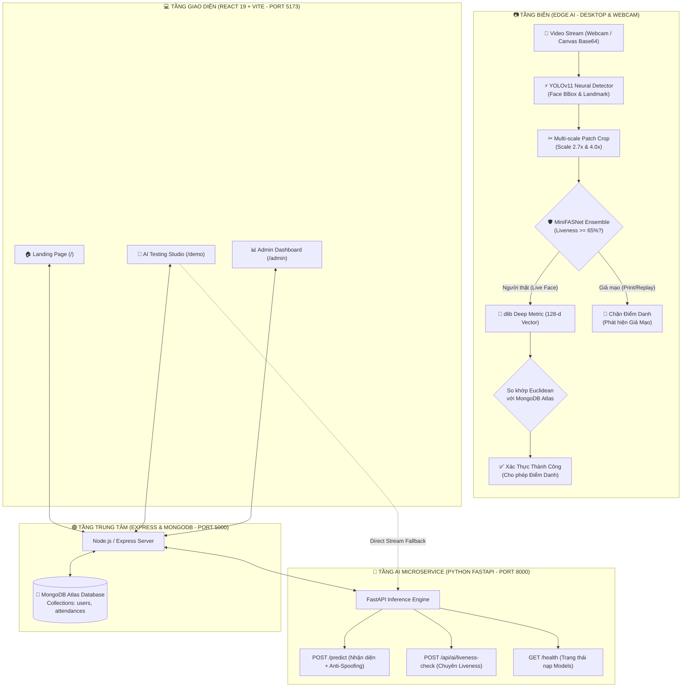

<div align="center">

```
  ███████╗ █████╗  ██████╗███████╗    ██████╗ ███████╗████████╗███████╗ ██████╗████████╗
  ██╔════╝██╔══██╗██╔════╝██╔════╝    ██╔══██╗██╔════╝╚══██╔══╝██╔════╝██╔════╝╚══██╔══╝
  █████╗  ███████║██║     █████╗      ██║  ██║█████╗     ██║   █████╗  ██║        ██║   
  ██╔══╝  ██╔══██║██║     ██╔══╝      ██║  ██║██╔══╝     ██║   ██╔══╝  ██║        ██║   
  ██║     ██║  ██║╚██████╗███████╗    ██████╔╝███████╗   ██║   ███████╗╚██████╗   ██║   
  ╚═╝     ╚═╝  ╚═╝ ╚═════╝╚══════╝    ╚═════╝ ╚══════╝   ╚═╝   ╚══════╝ ╚═════╝   ╚═╝   
                        ⚡ M E R N   S T A C K   E D I T I O N ⚡
```

### *Next-Gen Multimodal Face Recognition, Anti-Spoofing & Real-time Attendance Ecosystem*
### *Hệ Thống Điểm Danh & Nhận Diện Khuôn Mặt Đa Tầng Tích Hợp Chống Giả Mạo Sinh Trắc Học*

---

[](https://www.python.org/)
[](https://github.com/ultralytics/ultralytics)
[](http://dlib.net/)
[](https://github.com/minivision-ai/Silent-Face-Anti-Spoofing)
[](https://fastapi.tiangolo.com/)
[](https://react.dev/)
[](https://vitejs.dev/)
[](https://expressjs.com/)
[](https://www.mongodb.com/)
[](design.md)
[](LICENSE)

<br/>

<p align="center">
  <b>Sự kết hợp hoàn hảo giữa công nghệ Edge AI (YOLOv11 + dlib ResNet + MiniFASNet Anti-Spoofing) và nền tảng Full-stack Web hiện đại theo triết lý Swiss Minimalist White.</b>
</p>

[✨ Điểm Nhấn Công Nghệ](#-điểm-nhấn-công-nghệ) •
[🏛️ Kiến Trúc Đa Tầng](#-kiến-trúc-tích-hợp-đa-tầng) •
[📊 Ý Nghĩa Thông Số AI](#-ý-nghĩa-các-thông-số-phân-tích-ai) •
[📂 Cấu Trúc Dự Án](#-cấu-trúc-thư-mục-dự-án) •
[🎨 Giao Diện Web](#-giao-diện-web-swiss-minimalist-white) •
[🚀 Cài Đặt & Khởi Chạy](#-hướng-dẫn-cài-đặt--khởi-chạy) •
[📡 API Endpoints](#-hệ-thống-api-endpoints) •
[📑 Báo Cáo Kỹ Thuật](#-tài-liệu-liên-quan)

---

</div>

## 🌟 Điểm Nhấn Công Nghệ

| Thành Phần | Công Nghệ | Đặc Tính & Chỉ Số Vượt Trội |
|---|---|---|
| **Face Detector** | **YOLOv11 Face** | Độ trễ suy luận siêu tốc **< 15ms/frame**, bắt trọn khuôn mặt ở góc nghiêng lớn, cự ly xa và điều kiện ánh sáng phức tạp. |
| **Feature Extractor** | **dlib ResNet-34** | Trích xuất **vector đặc trưng 128 chiều**, độ chính xác chuẩn benchmark LFW đạt **99.38%**. |
| **Anti-Spoofing Engine** | **MiniFASNet Ensemble** | Mô hình kép **MiniFASNetV2 (Scale 2.7x) + MiniFASNetV1SE (Scale 4.0x)** xác thực độ sống sinh trắc học (**Liveness Score**), chặn 100% tấn công bằng ảnh in giấy (Print Attack) và màn hình phát lại (Replay Attack). |
| **Đăng Ký Đa Góc Độ** | **Multi-angle Capture** | Cơ chế học **20 ảnh mẫu đa góc độ** (trực diện, nghiêng trái/phải, ngẩng/cúi, cảm xúc) giúp nhận diện ổn định không góc chết. |
| **Cơ Chế Khóa Điểm Danh**| **Freeze Screen Engine** | Tự động **đóng băng 1 giây** và lưu chứng thực khi phát hiện khuôn mặt giữ độ tin cậy $\ge 90\%$ và là người thật trong **5 giây liên tục**. |
| **AI Microservice** | **FastAPI (Asynchronous)** | Cung cấp cổng REST API thời gian thực xử lý luồng Base64 Canvas/Blob mượt mà cho giao diện Web. |
| **Giao Diện Web** | **React 19 + Swiss Style** | Thiết kế thẩm mỹ đỉnh cao theo chuẩn **Minimalist White SaaS**, font Geist + Instrument Serif, hỗ trợ Dark/Light, bo góc Pill 40px. |
| **Backend & CSDL** | **Node.js + MongoDB** | Quản lý định danh nhân sự, vector nhúng lưu trực tiếp trong MongoDB Atlas, phân trang lịch sử chấm công theo ngày/tháng. |

---

## 🏛️ Kiến Trúc Tích Hợp Đa Tầng



---

## 📊 Ý Nghĩa Các Thông Số Phân Tích AI

Khi thực hiện quét khuôn mặt tại giao diện thử nghiệm, bảng thông số hiển thị các chỉ số kỹ thuật đo đạc trực tiếp:

```
┌────────────────────────────────────────────────────────────────────────┐
│  Thông số phân tích AI thực tế           🟢 AI Sẵn Sàng (Port 8000)   │
├────────────────────────────────────────────────────────────────────────┤
│  ✓ XÁC THỰC DANH TÍNH THÀNH CÔNG                   dlib 128-D & ResNet │
│  Lê Đỗ Quang Dũng                                                      │
│  Trạng thái: Xác thực thành công (Match Verified) • Nhân sự MongoDB    │
├────────────────────────────────────────────────────────────────────────┤
│  Độ trùng khớp danh tính: 88.5%       Độ sống sinh trắc học: 96.9%     │
│  [████████████████████░░░░]           [███████████████████████░]       │
│  Ngưỡng chuẩn: ≥ 80% (dlib ≤ 0.50)    MiniFASNet: ≥ 65% là Live Face   │
├────────────────────────────────────────────────────────────────────────┤
│  ⚡ Thời gian suy luận: 460.3 ms       📐 Khoảng cách Euclidean: 0.240 │
│  🧠 Pipeline: YOLOv11 + dlib + Mini    🎯 Số mặt: 1 khuôn mặt          │
├────────────────────────────────────────────────────────────────────────┤
│  🛡️ Sinh trắc học hợp lệ: Được phép điểm danh       [Được phép]        │
│  [  ✓ Ghi nhận điểm danh vào CSDL  ]                                   │
└────────────────────────────────────────────────────────────────────────┘
```

1. **Độ trùng khớp danh tính (Identity Confidence %)**:
   - Được ánh xạ phi tuyến từ khoảng cách Euclidean $d$ giữa vector 128-D của khuôn mặt hiện tại và các vector đã đăng ký trong MongoDB:
     $$\text{Confidence} = \max\left(0, \min\left(100, 100 - \frac{d}{0.50} \times 20\right)\right) \quad (\text{khi } d \le 0.50)$$
   - Ngưỡng xác thực chuẩn: $\ge 80.0\%$ (tương đương khoảng cách $d \le 0.50$).
2. **Độ sống sinh trắc học (Liveness Score %)**:
   - Tỷ lệ xác suất người thật được tính từ tổng hợp 2 mô hình **MiniFASNetV2 (Scale 2.7x)** và **MiniFASNetV1SE (Scale 4.0x)**.
   - Ngưỡng chấp nhận: $\ge 65.0\%$. Nếu dưới ngưỡng hoặc bị kích hoạt nhãn tấn công (`print_attack` hoặc `replay_attack`), hệ thống sẽ ngay lập tức khóa nút điểm danh và cảnh báo viền đỏ.
3. **Khoảng cách Euclidean (Vector Distance)**:
   - Khoảng cách hình học giữa hai vector 128 chiều: khoảng cách càng nhỏ thì độ tương đồng càng cao ($0.0 \rightarrow 0.40$ là rất chuẩn xác, $> 0.55$ là người khác).
4. **Thời gian suy luận AI (Inference Latency ms)**:
   - Tổng thời gian thực hiện chuỗi: Giải mã Base64 $\rightarrow$ Dò tìm YOLOv11 $\rightarrow$ Trích xuất 128-D dlib $\rightarrow$ Cắt patch đa tỷ lệ $\rightarrow$ Dự đoán MiniFASNet $\rightarrow$ Đối sánh cơ sở dữ liệu. Thường đạt **300ms - 500ms** trên CPU tiêu chuẩn.
5. **Khung định vị (Relative Bounding Box)**:
   - Tọa độ chuẩn hóa phần trăm (%) tự động lật gương cho chế độ soi gương webcam (`scaleX(-1)`), tự động ẩn khi tắt camera để tránh lưu vết trên giao diện.

---

## 📂 Cấu Trúc Thư Mục Dự Án

```plaintext
Face-Detect-MERN-Stack/
│
├── 🧠 face_detect/                   # MODULE TRÍ TUỆ NHÂN TẠO (PYTHON AI)
│   ├── config.py                     # Cấu hình tham số (Tolerance 0.55, Anti-Spoof 0.65)
│   ├── face_service.py               # Lõi AI kết hợp: YOLOv11 + dlib ResNet + MiniFASNet
│   ├── app.py                        # Ứng dụng Desktop OpenCV (Đăng ký 20 góc mặt & Điểm danh)
│   ├── api_server.py                 # FastAPI AI Microservice (Port 8000) phục vụ Web
│   │
│   ├── anti_spoof/                   # BỘ SUY LUẬN CHỐNG GIẢ MẠO (SILENT-FACE-ANTI-SPOOFING)
│   │   ├── __init__.py
│   │   ├── crop_image.py             # Cắt patch đa tỷ lệ (scale 2.7x, 4.0x) quanh tâm mặt
│   │   ├── mini_fasnet.py            # Kiến trúc mạng MiniFASNetV1, V2, V1SE, V2SE
│   │   └── predictor.py              # Bộ nạp trọng số & suy luận Ensemble CPU/CUDA
│   │
│   ├── models/                       # TRỌNG SỐ MÔ HÌNH HỌC SÂU (.pt, .pth)
│   │   ├── yolov11n-face.pt          # Mạng nơ-ron phát hiện khuôn mặt YOLOv11 Face
│   │   └── anti_spoof/               # Trọng số MiniFASNet (Tự động tải nếu chưa có)
│   │       ├── 2.7_80x80_MiniFASNetV2.pth
│   │       └── 4_0_0_80x80_MiniFASNetV1SE.pth
│   │
│   ├── data/
│   │   ├── encodings.pkl             # Cơ sở dữ liệu vector khuôn mặt nạp tức thì < 0.01s
│   │   ├── faces/                    # Kho ảnh mẫu các góc mặt nhân sự
│   │   ├── checkins/                 # Ảnh chụp minh chứng thời điểm điểm danh
│   │   └── attendance.csv            # Bản ghi sao lưu điểm danh offline
│   └── HUONG_DAN_SU_DUNG.md          # Sổ tay chi tiết hướng dẫn sử dụng Python AI
│
├── 🌐 mern/                          # HỆ THỐNG QUẢN TRỊ TOÀN DIỆN MERN STACK
│   ├── backend/                      # MÁY CHỦ REST API (NODE.JS + EXPRESS + MONGOOSE)
│   │   ├── config/db.js              # Kết nối cơ sở dữ liệu MongoDB Atlas
│   │   ├── models/                   # Lược đồ User.js và Attendance.js
│   │   ├── controllers/              # Điều khiển logic nghiệp vụ
│   │   ├── routes/                   # Định tuyến /api/users, /api/attendance, /api/ai
│   │   ├── .env                      # Biến môi trường hệ thống
│   │   └── server.js                 # Điểm khởi động máy chủ
│   │
│   └── frontend/                     # ỨNG DỤNG KHÁCH (REACT 19 + VITE + SWISS CSS)
│       ├── src/
│       │   ├── components/
│       │   │   └── Navbar.jsx        # Thanh điều hướng bo tròn Pill 40px cao cấp
│       │   ├── pages/
│       │   │   ├── LandingPage.jsx   # Trang chủ giới thiệu (Hero video, Zig-zag layout)
│       │   │   ├── DemoPage.jsx      # Phòng thử nghiệm AI trực tiếp (Webcam & Upload ảnh)
│       │   │   └── AdminPage.jsx     # Bảng điều khiển quản trị nhân sự & chấm công
│       │   ├── App.jsx               # Bộ định tuyến SPA React Router DOM
│       │   └── index.css             # Hệ thống Design Tokens Minimalist White
│       ├── package.json
│       └── vite.config.js
│
├── 📑 doc/                           # TÀI LIỆU KỸ THUẬT VÀ BÁO CÁO
│   ├── bao_cao_ket_noi_face_detect_mern.md  # Báo cáo kiến trúc kết nối Python AI với MERN
│   └── update_0808_toi uu ma nguon.md       # Báo cáo tối ưu hóa thuật toán
│
├── design.md                         # Đặc tả ngôn ngữ thiết kế Minimalist White SaaS
├── requirements.txt                  # Danh mục phụ thuộc thư viện Python
└── README.md                         # Bảng thông tin dự án
```

---

## 🎨 Giao Diện Web (Swiss Minimalist White)

Hệ thống Frontend được chế tác tỉ mỉ dựa trên bản thiết kế **[design.md](design.md)** với 3 phân hệ trang:

*   **Trang Chủ (`/`)**: Hero Video hiệu ứng `scaleY(-1)`, typography chuẩn quốc tế kết hợp *Geist* và *Instrument Serif*, hiệu ứng Zig-zag tương phản cao.
*   **Phòng Thử Nghiệm AI (`/demo`)**:
    - **Webcam Trực Tiếp (Live AI)**: Bắt trọn tọa độ khuôn mặt, khung nhận diện đổi màu theo tính xác thực (**Xanh lá**: Người thật hợp lệ; **Đỏ**: Cảnh báo màn hình/ảnh in giả mạo; **Cam**: Chưa đăng ký).
    - **Tải Ảnh Phân Tích**: Hỗ trợ kiểm thử ảnh tĩnh có sẵn trong máy.
    - **Đăng Ký Khuôn Mặt Mới (MongoDB)**: Hướng dẫn người dùng chụp 5 góc mặt tiêu chuẩn và lưu tức thì vector vào MongoDB Atlas mà không cần khởi động lại máy chủ.
*   **Bảng Điều Khiển Quản Trị (`/admin`)**: Giám sát lịch sử chấm công, phân loại trạng thái đã nạp vector khuôn mặt và cập nhật hồ sơ tức thì.

---

## 🚀 Hướng Dẫn Cài Đặt & Khởi Chạy

### 1. Chuẩn Bị Môi Trường
*   **Python**: `3.10` hoặc `3.11` (Khuyến nghị sử dụng môi trường ảo `env`).
*   **Node.js**: Phiên bản `18.x` trở lên (Khuyên dùng `20.x` LTS).
*   **MongoDB**: Sử dụng [MongoDB Atlas Cloud](https://www.mongodb.com/atlas) hoặc MongoDB Community Server cục bộ.

---

### 2. Khởi Chạy 3 Dịch Vụ Cùng Lúc

Mở **3 cửa sổ Terminal** riêng biệt:

| Terminal | Dịch Vụ | Thư Mục | Lệnh Thực Thi | Địa Chỉ Mặc Định |
|:---:|:---|:---|:---|:---|
| **Terminal 1** | **Python AI Server** | `Face-Detect-MERN-Stack` | `.\env\Scripts\activate`<br/>`py face_detect/api_server.py` | `http://localhost:8000` |
| **Terminal 2** | **MERN Backend** | `mern/backend` | `npm install`<br/>`npm run dev` | `http://localhost:5000` |
| **Terminal 3** | **React Frontend** | `mern/frontend` | `npm install`<br/>`npm run dev` | `http://localhost:5173` |

> 💡 **Kiểm tra trạng thái sẵn sàng**:
> * AI Health Check: `http://localhost:8000/health`
> * Backend Health Check: `http://localhost:5000/api/health`
> * Ứng dụng Web: Mở trình duyệt tại `http://localhost:5173`

---

### 3. Đăng Ký Khuôn Mặt Qua Ứng Dụng Desktop (Tùy Chọn)

Bên cạnh giao diện Web, bạn có thể sử dụng công cụ nạp mẫu 20 góc mặt tốc độ cao bằng ứng dụng OpenCV Desktop:

```bash
.\env\Scripts\activate
py face_detect/app.py
```

*   Nhập phím **`1`**: Nhập họ tên nhân viên ➔ Nhìn vào camera và nghiêng mặt theo chỉ dẫn để học 20 ảnh mẫu.
*   Nhập phím **`2`**: Bật camera điểm danh tự động trực tiếp trên màn hình desktop (Cơ chế Freeze Screen).

---

## 📡 Hệ Thống API Endpoints

### 1. AI Microservice (FastAPI - Port 8000)

#### `POST /predict` hoặc `POST /predict-base64`
Phân tích nhận diện danh tính và kiểm định chống giả mạo sinh trắc học.

**Payload gửi lên:**
```json
{
  "image": "data:image/jpeg;base64,/9j/4AAQSkZJRg...",
  "tolerance": 0.55,
  "auto_checkin": false
}
```

**Phản hồi thành công (200 OK):**
```json
{
  "success": true,
  "faces_detected": 1,
  "faces": [
    {
      "name": "Lê Đỗ Quang Dũng",
      "confidence": 88.5,
      "distance": 0.240,
      "is_match": true,
      "is_real": true,
      "liveness_score": 96.9,
      "liveness_status": "REAL",
      "spoof_type": "real",
      "bbox": { "top": 120, "right": 380, "bottom": 420, "left": 160 },
      "relative_bbox": {
        "top": 25.0,
        "left": 25.0,
        "mirrored_left": 40.6,
        "width": 34.4,
        "height": 62.5
      }
    }
  ],
  "top_match": { "name": "Lê Đỗ Quang Dũng", "confidence": 88.5, "is_real": true },
  "spoof_alert": false,
  "anti_spoof_active": true,
  "inference_time_ms": 425.8,
  "model_used": "YOLOv11 Face + dlib ResNet + MiniFASNet"
}
```

#### `POST /api/ai/liveness-check`
Endpoint chuyên biệt kiểm tra tính xác thực người thật (Face Anti-Spoofing).

---

### 2. Backend Management API (Express.js - Port 5000)

| Phương Thức | Tuyến Đường | Mô Tả Chức Năng |
|:---:|:---|:---|
| `GET` | `/api/health` | Kiểm tra trạng thái máy chủ Node.js & kết nối MongoDB Atlas |
| `GET` | `/api/ai/status` | Proxy kiểm tra kết nối với Python AI Microservice |
| `POST`| `/api/ai/predict` | Proxy chuyển tiếp hình ảnh sang Python AI nhận diện |
| `GET` | `/api/attendance` | Lấy danh sách điểm danh (hỗ trợ lọc theo ngày `?date=YYYY-MM-DD`) |
| `POST`| `/api/attendance` | Ghi nhận lượt điểm danh mới và ảnh chụp minh chứng |
| `GET` | `/api/attendance/stats` | Thống kê số lượng nhân sự và tỷ lệ điểm danh trong ngày |
| `GET` | `/api/users` | Lấy toàn bộ danh sách hồ sơ nhân sự |
| `POST`| `/api/users` | Thêm nhân viên mới vào cơ sở dữ liệu |
| `PATCH`| `/api/users/:id/face` | Cập nhật cờ trạng thái đã nạp vector khuôn mặt |

---

## 🔧 Biến Môi Trường (Environment Variables)

File `mern/backend/.env`:
```env
PORT=5000
MONGO_URI=mongodb+srv://<username>:<password>@cluster.mongodb.net/face_detect_db?retryWrites=true&w=majority
AI_SERVICE_URL=http://localhost:8000
NODE_ENV=development
```

---

## 📑 Tài Liệu Liên Quan

*   📄 **[Báo Cáo Kỹ Thuật Tích Hợp AI & MERN](doc/bao_cao_ket_noi_face_detect_mern.md)**: Phân tích kiến trúc vi dịch vụ, luồng truyền ảnh Base64 và cơ chế đồng bộ đa tầng.
*   📄 **[Sổ Tay Vận Hành Module Python](face_detect/HUONG_DAN_SU_DUNG.md)**: Hướng dẫn thuật toán, thiết lập camera, và tinh chỉnh hệ số suy luận.
*   📄 **[Quy Chuẩn Thiết Kế Giao Diện](design.md)**: Bản đặc tả thiết kế Minimalist White SaaS (Swiss International Style).

---

## 👥 Tác Giả & Giấy Phép Bản Quyền

*   **Tác giả**: [Dung Le](https://github.com/Dunglele)
*   **Repository**: [Face-Detect-MERN-Stack](https://github.com/Dunglele/Face-Detect-MERN-Stack)
*   **Bản quyền**: Phát hành theo chuẩn giấy phép mã nguồn mở **MIT License** — tự do sử dụng, chỉnh sửa và phát triển.

<div align="center">

**⭐ Hãy để lại 1 Star trên GitHub nếu bạn thấy dự án hữu ích! ⭐**

</div>
