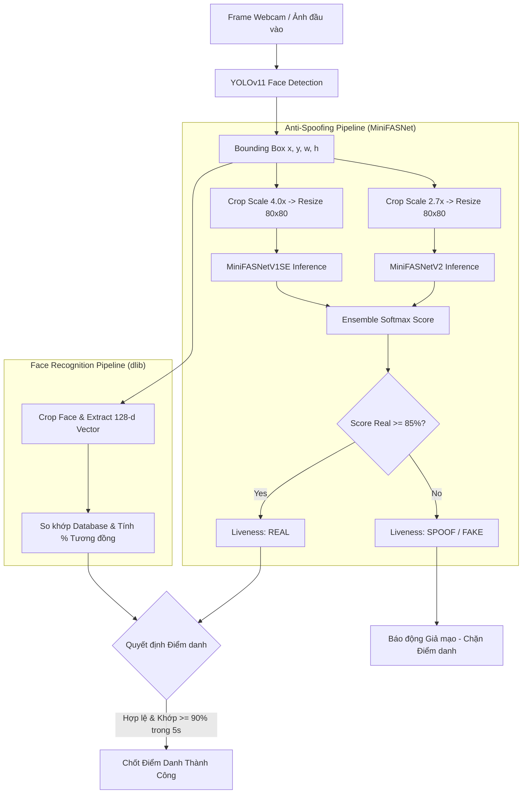

# Kế hoạch tích hợp mô hình Anti-Spoofing / Liveness Detection với MiniFASNet

Hệ thống hiện tại sử dụng mô hình lai **YOLOv11-Face** (phát hiện góc mặt) và **dlib ResNet** (trích xuất 128-d vector nhận diện). Tuy nhiên, hệ thống chưa có khả năng phân biệt giữa **khuôn mặt người thật (Live)** và **khuôn mặt giả mạo (Spoof)** như ảnh chụp in trên giấy (Print Attack), ảnh/video chiếu trên màn hình điện thoại/laptop (Replay Attack) hoặc mặt nạ.

Kế hoạch này tích hợp giải pháp **Silent-Face-Anti-Spoofing** dựa trên kiến trúc **MiniFASNet** (MiniFASNetV2 và MiniFASNetV1SE) để xác thực người thật theo thời gian thực (Zero-Interaction Liveness Detection), nâng cao tính bảo mật cho chấm công và xác thực danh tính.

---

## 1. Tổng quan Kiến trúc MiniFASNet Anti-Spoofing

MiniFASNet là kiến trúc mạng nơ-ron tích chập siêu nhẹ (Lightweight CNN) được thiết kế đặc thù cho bài toán Face Anti-Spoofing:
- **Kích thước siêu nhẹ**: Mỗi mô hình chỉ khoảng ~1.8 MB (tổng cộng ~3.6 MB cho ensemble).
- **Tốc độ suy luận cực nhanh**: Chỉ mất ~8-15ms trên CPU thông thường, hoàn toàn đáp ứng thời gian thực (Real-time 30-60 FPS).
- **Cơ chế Multi-scale Patch Crop**:
  - **Scale 2.7x** (`2.7_80x80_MiniFASNetV2.pth`): Cắt vùng mặt cận cảnh để phân tích các chi tiết bề mặt da người, lỗ chân lông, độ phản quang tự nhiên so với chất liệu giấy in.
  - **Scale 4.0x** (`4_0_0_80x80_MiniFASNetV1SE.pth`): Cắt mở rộng vùng mặt và bối cảnh xung quanh để nhận diện viền điện thoại, mép giấy in, vân sọc màn hình (Moiré pattern) hoặc ánh sáng màn hình phản xạ.
- **Phân loại 3 lớp (Softmax)**:
  - Lớp 0: Giả mạo bằng ảnh in (Print Attack).
  - Lớp 1: **Khuôn mặt người thật (Real Face)**.
  - Lớp 2: Giả mạo bằng màn hình video/điện thoại (Replay Attack).
- **Kết quả Ensemble**: Điểm tin cậy người thật $S_{real} = \frac{P_1^{(model1)} + P_1^{(model2)}}{2}$. Nếu $S_{real} \ge \text{threshold}$ (mặc định 0.85 hoặc 85%) thì xác thực là người thật.



---

## 2. User Review Required (Những điểm cần lưu ý & Thống nhất)

> [!IMPORTANT]
> **1. Chặn điểm danh khi phát hiện giả mạo:**
> Nếu hệ thống phát hiện khuôn mặt là giả mạo (`is_real == False` hoặc điểm sống < 85%), hệ thống sẽ **lập tức từ chối chấm công tự động** dù khuôn mặt có độ tương đồng danh tính cao (ví dụ: dùng ảnh chụp của sếp để điểm danh lén).
> 
> **2. Tải trọng lượng mô hình (Model Weights):**
> Hai file mô hình `2.7_80x80_MiniFASNetV2.pth` và `4_0_0_80x80_MiniFASNetV1SE.pth` (~1.8 MB mỗi file) sẽ được tự động tải về thư mục `face_detect/models/anti_spoof/` từ kho lưu trữ chính thức nếu máy chưa có sẵn.
> 
> **3. Hiệu năng & Phần cứng:**
> Môi trường Python của dự án đã có sẵn `torch 2.14.0` và `opencv-python`. MiniFASNet chạy mượt mà trên CPU mà không cần GPU rời.

---

## 3. Đề xuất Thay đổi Chi tiết (Proposed Changes)

### Module AI & Anti-Spoofing (`face_detect/`)

#### [NEW] [mini_fasnet.py](file:///c:/Users/ASUS/Desktop/Face-Detect-MERN-Stack/face_detect/anti_spoof/mini_fasnet.py)
- Khai báo kiến trúc mạng nơ-ron `MiniFASNetV1`, `MiniFASNetV2`, `MiniFASNetV1SE`, `MiniFASNetV2SE` bằng PyTorch.
- Tích hợp khối tích chập Depthwise-Separable Convolution, Squeeze-and-Excitation (SE), BatchNorm và PReLU.

#### [NEW] [crop_image.py](file:///c:/Users/ASUS/Desktop/Face-Detect-MERN-Stack/face_detect/anti_spoof/crop_image.py)
- Thuật toán trích xuất patch khuôn mặt theo tỷ lệ mở rộng `scale` (2.7x và 4.0x) xung quanh tâm bounding box của YOLO.
- Đảm bảo xử lý tràn viền an toàn và chuẩn hóa về kích thước 80x80 pixel BGR.

#### [NEW] [predictor.py](file:///c:/Users/ASUS/Desktop/Face-Detect-MERN-Stack/face_detect/anti_spoof/predictor.py)
- Lớp `AntiSpoofPredictor`:
  - Nạp sẵn các mô hình vào bộ nhớ RAM/GPU **duy nhất một lần** khi khởi động (tránh đọc đĩa mỗi khung hình).
  - Hàm `predict(image, bbox)`: thực hiện suy luận song song qua 2 mô hình (scale 2.7 và 4.0), tính xác suất Softmax trung bình.
  - Trả về: `is_real: bool`, `liveness_score: float` (0 - 100%), `spoof_type: 'real' | 'spoof'`, `details: dict`.
  - Tự động kiểm tra và tải trọng số `.pth` nếu chưa tồn tại.

#### [MODIFY] [config.py](file:///c:/Users/ASUS/Desktop/Face-Detect-MERN-Stack/face_detect/config.py)
- Bổ sung các biến cấu hình Anti-Spoofing:
  - `ANTI_SPOOF_ENABLED = True` (bật/tắt tính năng chống giả mạo linh hoạt).
  - `ANTI_SPOOF_DIR = MODELS_DIR / "anti_spoof"`
  - `ANTI_SPOOF_THRESHOLD = 0.85` (ngưỡng xác thực người thật >= 85%).

#### [MODIFY] [face_service.py](file:///c:/Users/ASUS/Desktop/Face-Detect-MERN-Stack/face_detect/face_service.py)
- Khởi tạo thực thể `AntiSpoofPredictor` trong `FaceService.__init__()`.
- Trong hàm `recognize_faces_in_frame()`:
  - Sau khi YOLO phát hiện tọa độ khuôn mặt, chạy kiểm tra Anti-Spoofing cho từng khuôn mặt.
  - Bổ sung thông tin `is_real`, `liveness_score`, `liveness_status` vào danh sách kết quả trả về.
  - Thêm cờ `anti_spoof_verified`: nếu phát hiện ảnh giả, vô hiệu hóa cờ này để ngăn hệ thống điểm danh nhầm.

#### [MODIFY] [api_server.py](file:///c:/Users/ASUS/Desktop/Face-Detect-MERN-Stack/face_detect/api_server.py)
- Thêm thông tin `is_real` và `liveness_score` vào phản hồi JSON của `/predict`, `/predict-base64`, `/predict-binary`.
- Chặn tự động điểm danh (`auto_checkin`) nếu `is_real == False`:
  - Trả về cảnh báo `"Cảnh báo: Phát hiện hành vi giả mạo khuôn mặt (Spoof Attack)!"`.
- Thêm endpoint chuyên dụng: `POST /api/ai/liveness-check` nhận ảnh và trả về kết quả kiểm tra người thật độc lập.

#### [MODIFY] [app.py](file:///c:/Users/ASUS/Desktop/Face-Detect-MERN-Stack/face_detect/app.py)
- Cập nhật giao diện HUD trên camera thời gian thực:
  - **Mặt thật đã đăng ký**: Khung màu xanh lá `[TÊN - 95.2% | LIVE: 98%]`.
  - **Mặt thật chưa đăng ký**: Khung màu vàng `[Unknown | LIVE: 92%]`.
  - **Giả mạo (ảnh giấy / điện thoại)**: Khung màu đỏ cảnh báo nhấp nháy `[CANH BAO: GIA MAO (SPOOF) | 94% FAKE]`.
- Cập nhật điều kiện giữ 5 giây điểm danh tự động:
  - Chỉ tính thời gian giữ liên tục khi thỏa mãn đồng thời: `is_match == True` VÀ `confidence >= 90%` VÀ **`is_real == True`**.
  - Nếu đưa điện thoại hay ảnh in vào, thanh đếm 5 giây lập tức bị reset về 0 và hiển thị thông báo giả mạo.

---

### MERN Frontend (`mern/frontend/`)

#### [MODIFY] [DemoPage.jsx](file:///c:/Users/ASUS/Desktop/Face-Detect-MERN-Stack/mern/frontend/src/pages/DemoPage.jsx)
- Hiển thị huy hiệu trạng thái Liveness (Anti-Spoofing Badge):
  - 🛡️ **Người thật (Live Human)**: Màu xanh lục kèm tỷ lệ liveness %.
  - ⚠️ **Khuôn mặt giả mạo (Spoof Detected)**: Màu đỏ nổi bật cảnh báo ảnh in / màn hình.
- Thêm visual box đổi màu đỏ cảnh báo trên khung webcam nếu phát hiện khuôn mặt là ảnh giả.
- Ngăn chặn nút bấm ghi log điểm danh thủ công nếu khuôn mặt bị gắn cờ là giả mạo.

---

## 4. Kế hoạch Kiểm thử & Xác minh (Verification Plan)

### Kiểm thử Tự động (Automated Verification)
1. **Kiểm tra tải trọng số & khởi tạo mô hình**:
   ```powershell
   .\env\Scripts\python.exe -c "from face_detect.anti_spoof.predictor import AntiSpoofPredictor; p = AntiSpoofPredictor(); print('Model loaded successfully:', p.is_ready())"
   ```
2. **Kiểm thử phân loại với ảnh mẫu**:
   - Sử dụng ảnh khuôn mặt người thật và ảnh chụp lại qua màn hình điện thoại để kiểm tra điểm số đầu ra của MiniFASNet.
   ```powershell
   .\env\Scripts\python.exe -c "import cv2; from face_detect.face_service import FaceService; fs = FaceService(); frame = cv2.imread('face_detect/data/faces/.../sample_01.jpg'); print(fs.recognize_faces_in_frame(frame))"
   ```
3. **Kiểm thử API Endpoint**:
   - Gửi yêu cầu kiểm tra tới `POST http://localhost:8000/predict` với Base64 ảnh thật và ảnh giả mạo. Kiểm tra cấu trúc phản hồi `is_real` và `liveness_score`.

### Kiểm thử Thủ công (Manual Verification)
1. **Kiểm thử trực tiếp trên Webcam (`app.py` và `DemoPage.jsx`)**:
   - Nhìn trực tiếp vào webcam: Xác nhận khung hiển thị màu xanh và nhãn `LIVE` đạt trên 90%.
   - Đưa màn hình điện thoại đang mở ảnh khuôn mặt vào trước webcam: Xác nhận khung chuyển sang màu đỏ, nhãn `SPOOF/GIA MAO` kích hoạt và thanh điểm danh 5 giây bị chặn hoàn toàn.
   - Thử nghiệm với ảnh in trên giấy: Xác nhận hệ thống phân loại chính xác là Fake Face.
